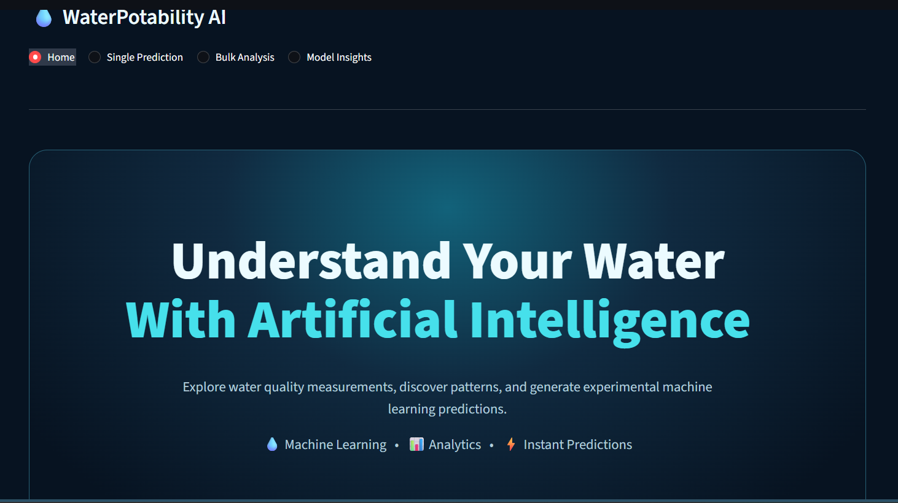
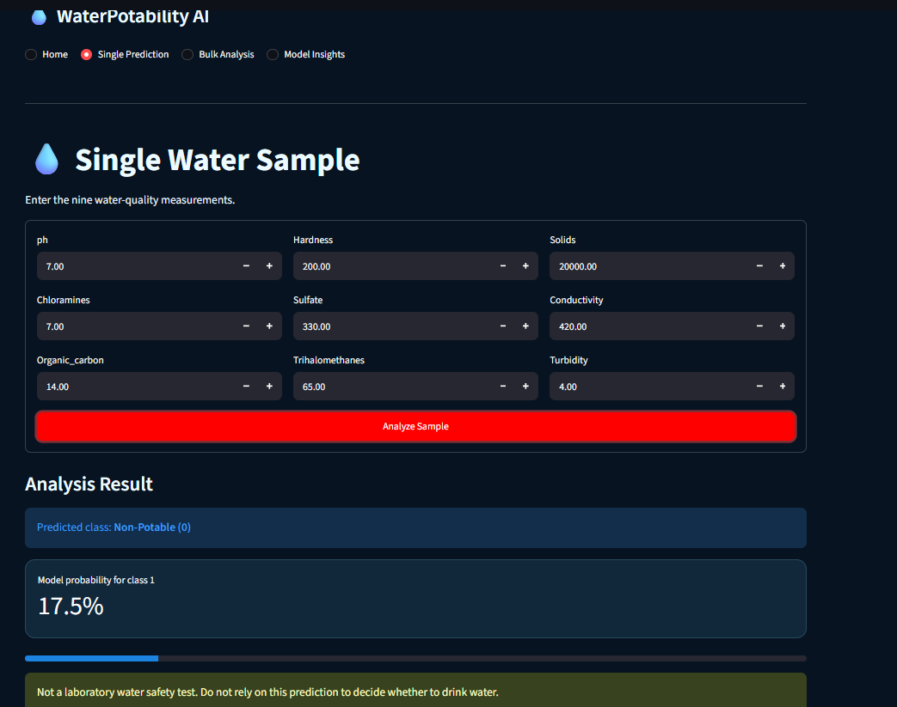
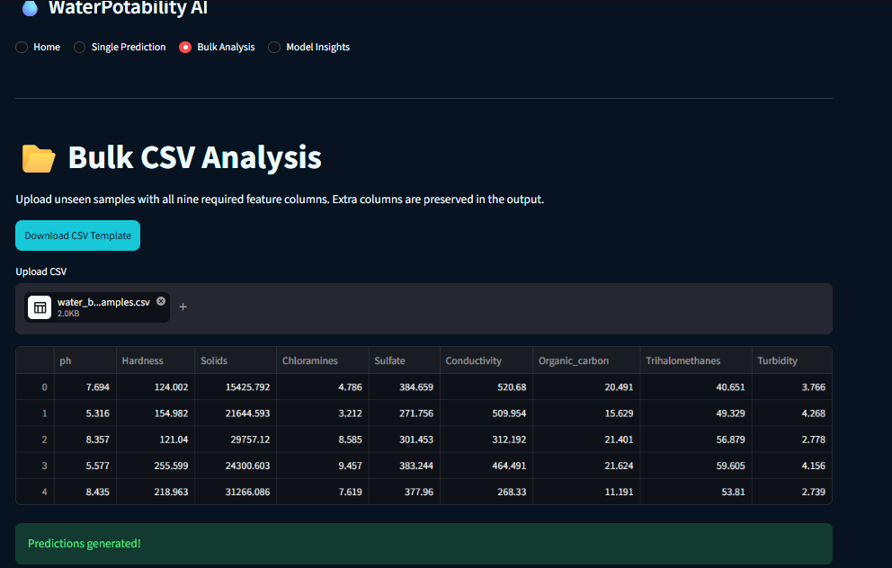
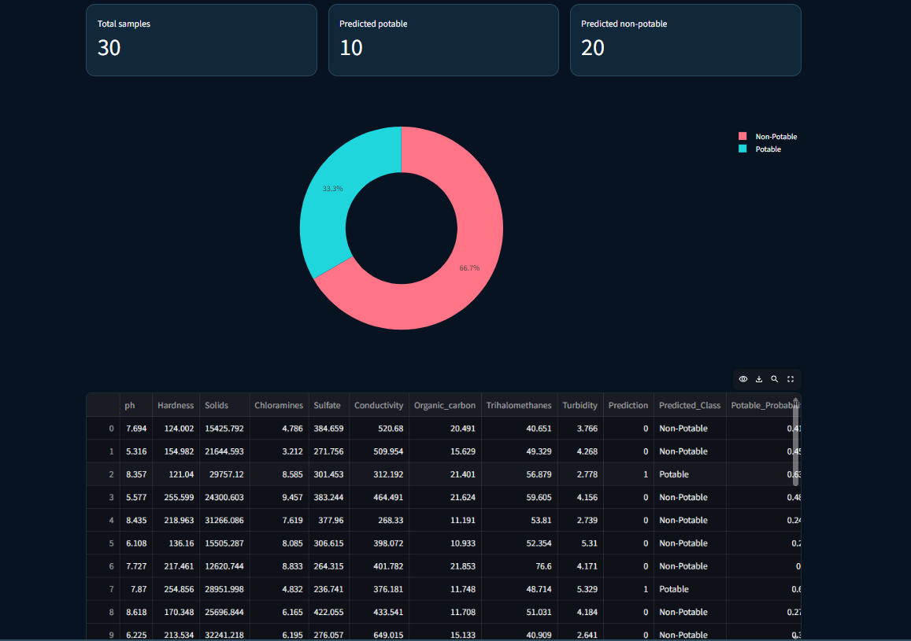

# 💧 WaterPotability AI

### Machine Learning-Based Water Quality Classification

An interactive Streamlit application that explores water-quality measurements using a Random Forest classifier. Features a cinematic dark-themed landing page, single-sample prediction, bulk CSV analysis, and model insights.

> **Disclaimer:** This is an educational ML demonstration, not a laboratory water-safety test. Do not use predictions to decide whether water is safe to drink.

## 📸 Application Screenshots

### 1. Cinematic Home Page


### 2. Single Water Sample Prediction
Enter nine water-quality measurements and view the model's predicted class and probability.



### 3. Bulk CSV Upload
Upload unseen samples in CSV format and preview the measurements.



### 4. Bulk Prediction Dashboard
Explore prediction counts, a distribution chart, and a downloadable results table.



## ✨ Features

- Single water sample classification using nine measured features
- Bulk CSV upload for unseen data
- Prediction probabilities and downloadable CSV results
- Model insights and feature importance
- Responsive, dark-themed Streamlit interface

## 🛠️ Tech Stack

Python · Pandas · NumPy · Scikit-learn · Streamlit · Plotly · Joblib

## 📊 Dataset and Model

The [Water Potability dataset](https://www.kaggle.com/datasets/adityakadiwal/water-potability) contains 3,276 rows and nine input features. Its real-world provenance is uncertain.

Two classifiers were explored: Logistic Regression and Random Forest. The selected Random Forest achieved the following results on the held-out test set:

| Metric | Result |
|---|---:|
| Accuracy | 67.07% |
| Non-potable recall | 91% |
| Potable recall | 30% |

These results indicate significant limitations in model reliability.

## 🚀 Run Locally

Place `water_model.pkl` and `imputer.pkl` alongside `app.py`, then run:

```bash
python -m pip install -r requirements.txt
python -m streamlit run app.py
```

Use model files saved from your own training notebook. Scikit-learn serialization can be version-sensitive; use a compatible environment.

## ⚠️ Limitations

Predictions are experimental, and model probabilities are not calibrated safety scores. Real drinking-water assessment requires appropriate laboratory testing.
